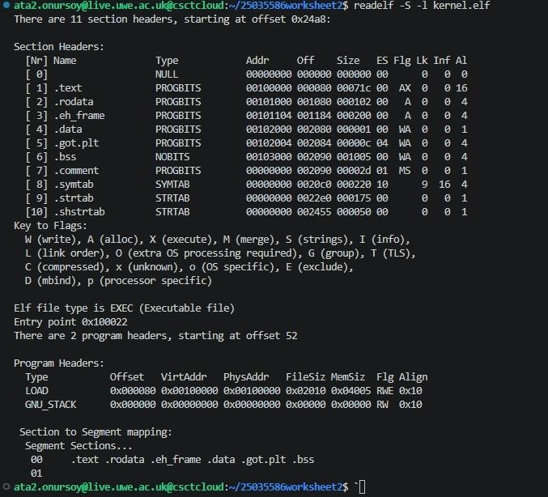
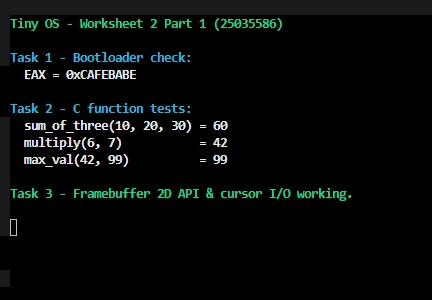
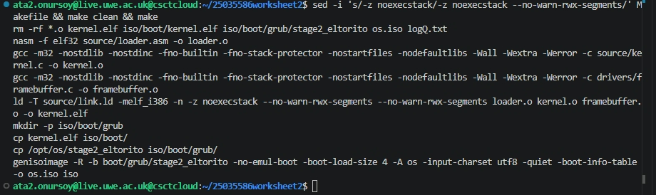

# UFCFWK-15-2 Operating Systems - Worksheet 2 Part 1

**Student Name:** Ata Deniz Onursoy  
**Student ID:** 25035586  

## Overview
This repository contains my implementation for Worksheet 2 Part 1, following Chapters 1 to 4 of *The Little Book of OS Development*. It builds a 32-bit x86 operating system kernel booted from scratch via GRUB Legacy (`stage2_eltorito`) in QEMU.

## Task 1 - Booting the Machine (20%)
The kernel entry point is implemented in `source/loader.asm`. To allow GRUB to validate and load the ELF binary at physical and virtual address `0x00100000` (1 MB), the Multiboot header constants (`MAGIC_NUMBER = 0x1BADB002`, `FLAGS = 0x0`, and `CHECKSUM = -0x1BADB002`) are aligned at the start of the `.text` segment via `source/link.ld`:

```nasm
MAGIC_NUMBER      equ 0x1BADB002
FLAGS             equ 0x0
CHECKSUM          equ -MAGIC_NUMBER

section .multiboot
align 4
    dd MAGIC_NUMBER
    dd FLAGS
    dd CHECKSUM
```

Inspecting the compiled ELF binary with `readelf -S -l kernel.elf` verifies that the `.text` section is mapped to `0x00100000` with entry point `0x100022` (`loader`):



When QEMU boots `os.iso`, SeaBIOS loads `stage2_eltorito` from the CD-ROM image:


This hands control over to the GNU GRUB Legacy bootloader menu configured in `iso/boot/grub/menu.lst`:


Upon booting the `os` entry, `loader` writes `0xCAFEBABE` into the `eax` register. Inspecting `logQ.txt` generated by QEMU (`-d cpu -D logQ.txt`) confirms that `EAX=cafebabe` is active in the CPU trace:


## Task 2 - Calling C from Assembler (20%)
Since bare-metal execution starts without a valid C stack, 4096 bytes (`KERNEL_STACK_SIZE equ 4096`) are reserved in the `.bss` section of `source/loader.asm`. Because the x86 stack grows downwards towards lower memory addresses, `esp` is initialized to the top of `kernel_stack` before calling `kmain`:

```nasm
loader:
    mov eax, 0xCAFEBABE
    mov esp, kernel_stack + KERNEL_STACK_SIZE
    call kmain
```

Running `nm -n kernel.elf` confirms the symbol layout in memory: `kernel_stack` starts at `0x00103000` and the next `.bss` symbol (`cursor_x`) starts at `0x00104000`, confirming the exact `0x1000` (4096-byte) stack allocation alongside the C function symbols (`sum_of_three`, `multiply`, `max_val`, and `kmain`):


In `source/kernel.c`, three C functions are implemented and called from `kmain` following the 32-bit `cdecl` calling convention:

```c
int sum_of_three(int arg1, int arg2, int arg3) {
    return arg1 + arg2 + arg3;
}

int multiply(int a, int b) {
    return a * b;
}

int max_val(int a, int b) {
    if (a > b) {
        return a;
    }
    return b;
}
```

## Task 3 - Framebuffer & I/O Driver API (40%)
The VGA text-mode driver is separated under `drivers/framebuffer.c`, `drivers/framebuffer.h`, and `drivers/io.h`. It writes characters and color bytes to memory-mapped I/O starting at `0x000B8000` (80x25 cells, 2 bytes per cell):

```c
void fb_write_cell(unsigned int i, char c, unsigned char fg, unsigned char bg) {
    char *fb = (char *) FB_ADDRESS;
    fb[i * 2] = c;
    fb[i * 2 + 1] = ((bg & 0x0F) << 4) | (fg & 0x0F);
}
```

Hardware cursor positioning uses x86 I/O ports `0x3D4` (command port) and `0x3D5` (data port) via the `outb` assembly wrapper:

```c
void fb_move_cursor(unsigned short pos) {
    outb(FB_COMMAND_PORT, FB_HIGH_BYTE_COMMAND);
    outb(FB_DATA_PORT, ((pos >> 8) & 0x00FF));
    outb(FB_COMMAND_PORT, FB_LOW_BYTE_COMMAND);
    outb(FB_DATA_PORT, pos & 0x00FF);
}
```

The 2D Framebuffer API (`fb_move(x, y)`, `fb_set_color(fg, bg)`, `fb_clear()`, `fb_put_char(c)`, `fb_print(str)`, `fb_print_num(num)`, and `fb_print_hex(num)`) is tested in `kmain` to display the Task 1 and Task 2 results on screen:



## Building and Running
The project compiles cleanly with NASM, GCC (`-m32 -nostdlib -nostdinc -fno-builtin -fno-stack-protector -nostartfiles -nodefaultlibs -Wall -Wextra -Werror`), GNU `ld`, and `genisoimage`:



```bash
make clean
make
make run
```

To close QEMU when running in curses mode, connect to the QEMU monitor from a second terminal:
```bash
telnet localhost 45454
(qemu) quit
```