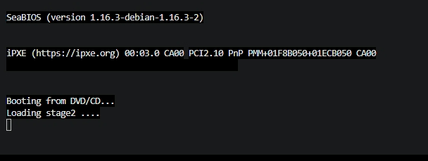
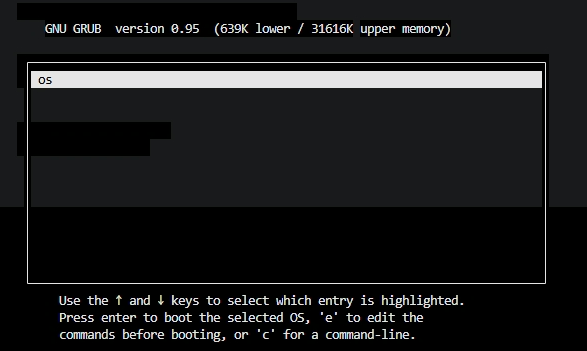
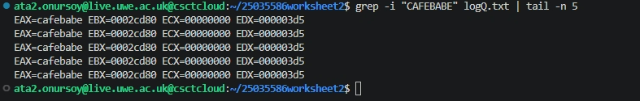
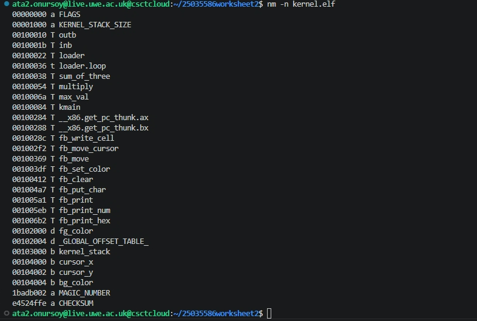
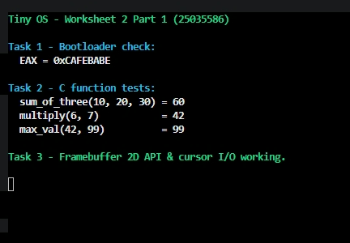
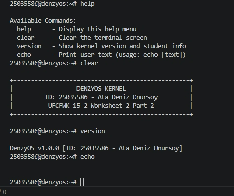

# UFCFWK-15-2 Operating Systems - Worksheet 2 (Part 1 & Part 2)

**Student Name:** Ata Deniz Onursoy  
**Student ID:** 25035586  
**Module:** UFCFWK-15-2 Operating Systems (UWE Bristol)  
**Target Environment:** CSCT Cloud / QEMU (`qemu-system-i386`)  

## Overview
This repository contains my implementation for Worksheet 2 (Part 1 and Part 2), following Chapters 1 to 4 (Part 1) and Chapter 6 (Part 2) of [*The Little Book of OS Development*](https://littleosbook.github.io/). It builds a 32-bit x86 operating system kernel booted from scratch via GRUB Legacy (`stage2_eltorito`) in QEMU, featuring a VGA framebuffer, IDT hardware interrupts, an interrupt-driven PS/2 keyboard driver with a circular input buffer, and an interactive command shell.

## Quick Summary (At a Glance)
If you want a fast overview of what this repository accomplishes, here is the breakdown of both project parts:

- **Part 1 (Booting & Framebuffer):** Implements multiboot compliance, a 32-bit stack setup, C-to-Assembly integration, and a VGA text-mode driver (`loader.asm`, `link.ld`, `kernel.c`, `framebuffer.c`).
- **Part 2 (Interrupts & Shell):** Implements IDT configuration, PIC remapping, COM1 serial port, a PS/2 keyboard driver, and an interactive shell (`interrupts.c`, `pic.c`, `keyboard.c`).

## Directory Structure  (Part 1 Baseline)
```text
25035586worksheet2/
├── drivers/
│   ├── framebuffer.c
│   ├── framebuffer.h
│   └── io.h
├── screenshots/
│   ├── build.png
│   ├── cafebabe_log.png
│   ├── elf_headers.png
│   ├── grub.png
│   ├── kernel_output.png
│   ├── seabios.png
│   └── stack_symbol.png
├── iso/
│   └── boot/
│       └── grub/
│           ├── menu.lst
│           └── stage2_eltorito
│       └── kernel.elf
├── source/
│   ├── kernel.c
│   ├── link.ld
│   └── loader.asm
├── .gitignore
├── Makefile
└── README.md
```

## Task 1 - Booting the Machine 
The kernel entry point is implemented in `source/loader.asm`. To allow GRUB to validate and load the ELF binary at physical and virtual address `0x00100000` (1 MB), the Multiboot header constants (`MAGIC_NUMBER = 0x1BADB002`, `FLAGS = 0x0`, and `CHECKSUM = -0x1BADB002`) are aligned at the start of the `.text` segment via `source/link.ld`:

```nasm
MAGIC_NUMBER      equ 0x1BADB002
FLAGS             equ 0x0
CHECKSUM          equ -MAGIC_NUMBER

section .multiboot
align 4
    dd MAGIC_NUMBER
    dd FLAGS
    dd CHECKSUM
```

Inspecting the compiled ELF binary with `readelf -S -l kernel.elf` verifies that the `.text` section is mapped to `0x00100000` with entry point `0x100022` (`loader`):


When QEMU boots `os.iso`, SeaBIOS loads `stage2_eltorito` from the CD-ROM image:



This hands control over to the GNU GRUB Legacy bootloader menu configured in `iso/boot/grub/menu.lst`:



Upon booting the `os` entry, `loader` writes `0xCAFEBABE` into the `eax` register. Inspecting `logQ.txt` generated by QEMU (`-d cpu -D logQ.txt`) confirms that `EAX=cafebabe` is active in the CPU trace:



## Task 2 - Calling C from Assembler 
Since bare-metal execution starts without a valid C stack, 4096 bytes (`KERNEL_STACK_SIZE equ 4096`) are reserved in the `.bss` section of `source/loader.asm`. Because the x86 stack grows downwards towards lower memory addresses, `esp` is initialized to the top of `kernel_stack` before calling `kmain`:

```nasm
loader:
    mov eax, 0xCAFEBABE
    mov esp, kernel_stack + KERNEL_STACK_SIZE
    call kmain
```

Running `nm -n kernel.elf` confirms the symbol layout in memory: `kernel_stack` starts at `0x00103000` and the next `.bss` symbol (`cursor_x`) starts at `0x00104000`, confirming the exact `0x1000` (4096-byte) stack allocation alongside the C function symbols (`sum_of_three`, `multiply`, `max_val`, and `kmain`):



In `source/kernel.c`, three C functions are implemented and called from `kmain` following the 32-bit `cdecl` calling convention:

```c
int sum_of_three(int arg1, int arg2, int arg3) {
    return arg1 + arg2 + arg3;
}

int multiply(int a, int b) {
    return a * b;
}

int max_val(int a, int b) {
    if (a > b) {
        return a;
    }
    return b;
}
```

## Task 3 - Framebuffer & I/O Driver API
The VGA text-mode driver is separated under `drivers/framebuffer.c`, `drivers/framebuffer.h`, and `drivers/io.h`. It writes characters and color bytes to memory-mapped I/O starting at `0x000B8000` (80x25 cells, 2 bytes per cell):

```c
void fb_write_cell(unsigned int i, char c, unsigned char fg, unsigned char bg) {
    char *fb = (char *) FB_ADDRESS;
    fb[i * 2] = c;
    fb[i * 2 + 1] = ((bg & 0x0F) << 4) | (fg & 0x0F);
}
```

Hardware cursor positioning uses x86 I/O ports `0x3D4` (command port) and `0x3D5` (data port) via the `outb` assembly wrapper:

```c
void fb_move_cursor(unsigned short pos) {
    outb(FB_COMMAND_PORT, FB_HIGH_BYTE_COMMAND);
    outb(FB_DATA_PORT, ((pos >> 8) & 0x00FF));
    outb(FB_COMMAND_PORT, FB_LOW_BYTE_COMMAND);
    outb(FB_DATA_PORT, pos & 0x00FF);
}
```

The 2D Framebuffer API (`fb_move(x, y)`, `fb_set_color(fg, bg)`, `fb_clear()`, `fb_put_char(c)`, `fb_print(str)`, `fb_print_num(num)`, and `fb_print_hex(num)`) is tested in `kmain` to display the Task 1 and Task 2 results on screen:



## Building and Running
The project compiles cleanly with NASM, GCC (`-m32 -nostdlib -nostdinc -fno-builtin -fno-stack-protector -nostartfiles -nodefaultlibs -Wall -Wextra -Werror`), GNU `ld`, and `genisoimage`:


```bash
make clean
make os.iso
make run          # -nographic, output/input on the terminal via COM1, logs CPU state to logQ.txt
make run-curses   # VGA framebuffer drawn with curses, PS/2 keyboard input, logs to logQ.txt
```

`make run` uses `-d cpu -D logQ.txt`, so `EAX=cafebabe` can be found in `logQ.txt` (exit with `Ctrl-A` then `X`).
In curses mode QEMU no longer receives `Ctrl-C`, so it is closed through the QEMU monitor from a second terminal:
```bash
telnet localhost 45454
(qemu) quit
```

When the kernel boots, `kmain` runs a test of the Task 2 functions and the Task 3 framebuffer API (numbers, hex, colours). The `move` shell command demonstrates `fb_move(x, y)` by writing text at the four corners and the centre of the screen.

# Worksheet 2 Part 2: Interrupts, Drivers & Shell

## Directory Structure (Part 2 Expansion)
```text
25035586worksheet2/
├── drivers/
│   ├── framebuffer.c
│   ├── framebuffer.h
│   ├── hardware_interrupt_enabler.h
│   ├── hardware_interrupt_enabler.s
│   ├── interrupt_asm.s
│   ├── interrupt_handlers.s
│   ├── interrupts.c
│   ├── interrupts.h
│   ├── io.h
│   ├── keyboard.c
│   ├── keyboard.h
│   ├── pic.c
│   ├── pic.h
│   └── types.h
├── screenshots/
│   ├── build.png
│   ├── cafebabe_log.png
│   ├── elf_headers.png
│   ├── grub.png
│   ├── kernel_output.png
│   ├── seabios.png
│   ├── shell_execution.png
│   └── stack_symbol.png
├── iso/
│   └── boot/
│       └── grub/
│           ├── menu.lst
│           └── stage2_eltorito
│       └── kernel.elf
├── source/
│   ├── kernel.c
│   ├── link.ld
│   └── loader.asm
├── .gitignore
├── Makefile
└── README.md
```


## Interrupt Setup - IDT & PIC
Before the keyboard can be used, an Interrupt Descriptor Table (IDT) is installed and the PIC is configured (`drivers/interrupts.c`, `drivers/pic.c`).

- **IDT:** `interrupts_install_idt()` fills a 32-bit interrupt gate for interrupt 33 (IRQ1, keyboard) and 36 (IRQ4, COM1), pointing at the assembly stubs generated by the `no_error_code_interrupt_handler` macro in `drivers/interrupt_asm.s`. The stubs save the registers, call the C `interrupt_handler`, restore them and `iret`. `load_idt` (`drivers/interrupt_handlers.s`) loads the table with `lidt`.
- **PIC remapping:** the master and slave PICs are remapped to `0x20` and `0x28` so hardware IRQs do not collide with CPU exceptions 0-31. `pic_remap` masks every IRQ, then only IRQ1 and IRQ4 are unmasked:

```c
pic_remap(PIC_1_OFFSET, PIC_2_OFFSET);
outb(0x21, inb(0x21) & ~((1 << 1) | (1 << 4)));   /* unmask IRQ1 (keyboard) and IRQ4 (COM1) */
```

- **Enabling interrupts:** `enable_hardware_interrupts()` / `disable_hardware_interrupts()` wrap `sti` / `cli` (`drivers/hardware_interrupt_enabler.s`).

## Part 2 Task 1 - Display Keyboard Input
`keyboard_read_scan_code()` reads the scan code from the keyboard data port `0x60`, and `keyboard_scan_code_to_ascii()` converts it with the US QWERTY table (key releases, which have bit 7 set, return 0). Reading port `0x60` is essential: until the byte is read the keyboard controller will not raise another interrupt.

The keyboard case of `interrupt_handler` reads every pending scan code, ignores break codes, converts it to ASCII and handles the three cases:

```c
case INTERRUPTS_KEYBOARD:
    while ((inb(0x64) & 1)) {
        input = keyboard_read_scan_code();
        if (!(input & 0x80)) {
            if (input <= KEYBOARD_MAX_ASCII) {
                ascii = keyboard_scan_code_to_ascii(input);
                if (ascii != 0) {
                    process_input_char(ascii);
                }
            }
        }
    }
    pic_acknowledge(interrupt);
    break;
```

`process_input_char()` shows the character and stores it in the input buffer:
- **Backspace:** `fb_backspace()` removes the last character. A `line_length` counter stops backspace from deleting the shell prompt.
- **Enter:** `fb_newline()` moves to the start of the next line (the screen scrolls when the bottom row is reached).
- **Regular character:** `fb_put_char()` displays it at the cursor.

`pic_acknowledge()` sends the end-of-interrupt so the PIC delivers the next key press.

## Part 2 Task 2 - Input Buffer API (`getc` / `readline`)
The interrupt handler and the rest of the kernel share a **circular buffer** of 256 bytes (`drivers/keyboard.c`). The handler is the only writer of `buffer_head`, `getc()` is the only reader of `buffer_tail`. Both indices are `volatile` because they change inside an interrupt.

```c
void keyboard_buffer_put(u8int c) {
    u32int next = (buffer_head + 1) % INPUT_BUFFER_SIZE;
    if (next == buffer_tail) {
        return;                 /* buffer full: drop the new character */
    }
    input_buffer[buffer_head] = c;
    buffer_head = next;
}
```

- **Empty / full:** one slot is always left unused, so `head == tail` means empty and `head + 1 == tail` means full. On overflow the newest character is dropped and the unread input is kept.
- **`getc()`** removes and returns one character. Interrupts are disabled while the buffer is read so the handler cannot change it half way through. If the buffer is empty the CPU waits with `sti; hlt` instead of busy-looping. `sti` only takes effect after the next instruction, so no key press can arrive between the empty check and the `hlt`:

```c
u8int getc(void) {
    while (1) {
        disable_hardware_interrupts();
        if (buffer_tail != buffer_head) {
            u8int c = input_buffer[buffer_tail];
            buffer_tail = (buffer_tail + 1) % INPUT_BUFFER_SIZE;
            enable_hardware_interrupts();
            return c;
        }
        __asm__ volatile("sti; hlt");
    }
}
```

- **`readline(buf, max_len)`** calls `getc()` until `'\n'`, applies backspaces to the stored line, never writes more than `max_len - 1` characters and always null-terminates the result.

**Serial input:** with `make run` (`-nographic`) there is no VGA window and no PS/2 keyboard, the terminal is connected to COM1. The UART is configured to raise IRQ4 on received data, and the COM1 case of `interrupt_handler` passes each byte (`\r` becomes `\n`, `DEL` becomes `\b`) through the same `process_input_char()`. The shell therefore works the same way in both run modes. Everything printed by the framebuffer driver is also copied to COM1 so it is visible in `-nographic` mode.

## Part 2 Task 3 - Terminal
The shell in `source/kernel.c` prints the prompt `25035586@denzyos:~#`, reads a line with `readline()`, splits it at the first space into the command name and its arguments, and looks the name up in a command table:

```c
struct command {
    const char *name;
    const char *usage;
    void (*function)(char *args);
};

static const struct command commands[] = {
    { "help",    "help      - Display this help menu",               cmd_help    },
    { "clear",   "clear     - Clear the terminal screen",            cmd_clear   },
    { "version", "version   - Show kernel version and student info", cmd_version },
    { "echo",    "echo      - Print user text (usage: echo [text])", cmd_echo    },
    { "sum",     "sum       - Call sum_of_three (usage: sum a b c)", cmd_sum     },
    ...
};
```

Empty lines and leading spaces are ignored. A name that is not in the table prints `Error: Unknown command. Type 'help' for assistance.`, and `sum` validates its three numeric arguments before calling `sum_of_three`.

Supported commands:
- **`help`**: lists the commands (generated from the table).
- **`clear`**: clears the screen and redraws the banner.
- **`version`**: shows the kernel version and student details.
- **`echo [text]`**: prints the arguments.
- **`sum a b c`**: parses three integers and calls the Part 1 `sum_of_three`.
- **`test`**: runs the Part 1 C function and framebuffer tests again.
- **`move`**: `fb_move(x, y)` demo.

### Interactive Shell Execution Evidence

*(Fig: DenzyOS interactive shell running with custom student banner, active prompt, and command outputs.)*

## Building and Running
The project compiles cleanly with NASM, GCC (`-m32 -nostdlib -nostdinc -fno-builtin -fno-stack-protector -nostartfiles -nodefaultlibs -Wall -Wextra -Werror`), GNU `ld`, and `genisoimage`:

```bash
make clean
make os.iso
make run          # terminal on COM1 (quit: Ctrl-A then X)
make run-curses   # VGA framebuffer + PS/2 keyboard
```

To close QEMU when running in curses mode, connect to the QEMU monitor from a second terminal:
```bash
telnet localhost 45454
(qemu) quit
```